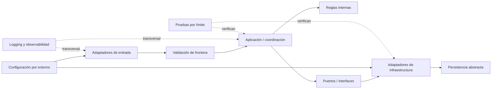

# Plan propuesto — Arquitectura base de Backend

**ID:** ARCH-BE-BASE · **Decisión:** `propuesto` · **Aprobación:** pendiente.  
Este es un plan documental futuro. No se ha creado proyecto, código ni infraestructura.

## Principio de organización

Proponer inicialmente límites lógicos dentro de una aplicación modular sencilla. La topología de despliegue queda abierta. No separar en microservicios sin necesidad, evidencia operativa y una decisión aprobada.

El diagrama describe responsabilidades futuras, no componentes implementados ni un stack seleccionado.

## Responsabilidades y reglas de dependencia

1. **Entrada:** adaptadores reciben transporte y traducen el protocolo; no alojan reglas de negocio.
2. **Validación:** valida sintaxis y límites en el borde; reglas invariantes no dependen de la interfaz.
3. **Aplicación:** coordina operaciones abstractas y decisiones transversales; depende de contratos internos, no de detalles de proveedor.
4. **Dominio:** representa reglas que se definan en futuras specs; en esta arquitectura base no se crean entidades de negocio.
5. **Puertos e infraestructura:** contratos y adaptadores encapsulan sistemas externos y persistencia, seleccionados más adelante.
6. **Configuración y seguridad:** configuración tipada por entorno; secretos inyectados por mecanismo aprobado y no almacenados en repositorio.
7. **Observabilidad:** salida estructurada, correlación y sanitización, sin secretos ni datos personales innecesarios.
8. **Pruebas:** unitarias de lógica aislada; integración de adaptadores; contrato en fronteras acordadas; pruebas de seguridad por amenaza.

## Secuencia futura

1. Confirmar alcance arquitectónico, restricciones y repositorio.
2. Evaluar alternativas compatibles con capacidad del equipo y registrar ADR de stack cuando se solicite.
3. Acordar límites y convenciones, sin módulos funcionales prematuros.
4. Preparar estructura técnica mínima después de aprobación.
5. Añadir configuración/errores/logging y puertos solo con requisitos aprobados.
6. Definir estrategia de pruebas y evidencia reproducible.
7. Revisar seguridad, mantenibilidad, dependencias y criterios de aceptación antes de cerrar.

## Validación futura

La tarea podrá comprobar dirección de dependencias, ausencia de secretos, variación de configuración por entorno, registro de decisiones, compilación del scaffold y pruebas arquitectónicas adecuadas al stack aprobado. Ninguno de estos controles se ejecutó en esta entrega.

## Riesgos y mitigaciones

- **Sobrearquitectura:** comenzar con límites lógicos y justificar cada adaptador/capa.
- **Stack prematuro:** comparar alternativas tras confirmar restricciones.
- **Fuga de secretos/datos:** revisar configuración, logging y ejemplos antes de aceptar.
- **Desalineación con Móvil:** acordar contratos genéricos compartidos sin decidir endpoints.

## Dependencias y aprobaciones

Depende de aprobación del alcance y decisiones D-02 a D-10 del registro global. Toda secuencia queda sujeta a revisión técnica y humana.
