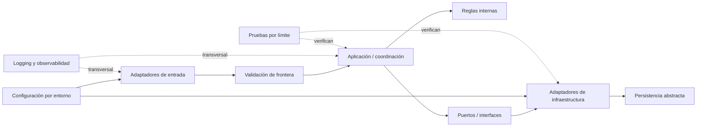

# Plan propuesto — Arquitectura base de Backend

**ID:** ARCH-BE-BASE · **Decisión:** `propuesto` · **Ejecución:** `no_iniciado` · **Verificación:** `no_ejecutada` · **Tipo:** `—`.
Este es un plan documental futuro. No se ha creado proyecto, código ni infraestructura.

## Principio de organización

Proponer inicialmente límites lógicos dentro de una aplicación modular sencilla. La topología de despliegue queda abierta. No separar en microservicios sin necesidad, evidencia operativa y una decisión aprobada.

## Alternativas no seleccionadas

- Microservicios, colas y despliegue distribuido: no justificados sin carga, límites operativos ni decisión aprobada.
- Framework, proveedor cloud, motor de persistencia y mecanismo de identidad: no seleccionados por falta de requisitos y autoridad de decisión.

El diagrama describe responsabilidades futuras, no componentes implementados ni un stack seleccionado.

## Responsabilidades y reglas de dependencia

1. **Entrada:** adaptadores reciben transporte y traducen el protocolo; no alojan reglas de negocio.
2. **Validación:** valida sintaxis y límites en el borde; reglas invariantes no dependen de la interfaz.
3. **Aplicación:** coordina operaciones abstractas y decisiones transversales; depende de contratos internos, no de detalles de proveedor.
4. **Dominio:** representa reglas que se definan en futuras specs; en esta arquitectura base no se crean entidades de negocio.
5. **Puertos e infraestructura:** contratos y adaptadores encapsulan sistemas externos y persistencia, seleccionados más adelante.
6. **Configuración, validación y seguridad:** configuración tipada por entorno; validación de entrada en límites de confianza; políticas de autorización en el servidor por recurso y operación cuando existan capacidades conectadas; secretos inyectados por mecanismo aprobado y no almacenados en repositorio.
7. **Observabilidad:** salida estructurada, correlación y sanitización, sin secretos ni datos personales innecesarios.
8. **Pruebas:** unitarias de lógica aislada; integración de adaptadores; contrato en fronteras acordadas; pruebas de seguridad por amenaza.

## Trazabilidad de requisitos

| Requisito | Sección del plan | Tarea futura | Validación futura |
|---|---|---|---|
| ARCH-BE-01 | Responsabilidades 1-5 | BE-AB-03 | Revisión de límites y dependencias |
| ARCH-BE-02 | Principio de organización | BE-AB-03 | Revisión de modularidad proporcional |
| ARCH-BE-03 | Responsabilidades 1-5 | BE-AB-03 | Ausencia de ciclos y acoplamiento indebido |
| ARCH-BE-04 | Responsabilidad 6 | BE-AB-04 | Revisión de entornos y valores sensibles |
| ARCH-BE-05 | Responsabilidad 5 | BE-AB-03, BE-AB-05 | Inspección de interfaces y dependencias |
| ARCH-BE-06 | Responsabilidades 1-3 y 6 | BE-AB-04 | Revisión de validación de entrada y redacción de errores |
| ARCH-BE-07 | Responsabilidad 6 | BE-AB-04, BE-AB-07 | Revisión de límites de confianza, políticas de autorización y secretos |
| ARCH-BE-08 | Responsabilidad 5 | BE-AB-05 | Inspección de abstracción de persistencia |
| ARCH-BE-09 | Responsabilidad 7 | BE-AB-04 | Revisión de correlación y sanitización |
| ARCH-BE-10 | Responsabilidad 8 | BE-AB-06 | Plan de pruebas por riesgo |
| ARCH-BE-11 | Responsabilidades 1-8 | BE-AB-07 | Revisión humana de documentación y trazabilidad |
| — (habilitadora) | Secuencia futura 1 | BE-AB-01 | Registro de alcance, fuentes y repositorio |
| — (habilitadora) | Secuencia futura 2 | BE-AB-02 | ADR de stack y topología justificado |

`BE-AB-01` y `BE-AB-02` no implementan requisitos funcionales; habilitan la evaluación de todos los `ARCH-BE-xx` y se registran como tareas habilitadoras.

`ARCH-BE-07` se verifica documentalmente con la política de autorización de `BE-AB-04` y la revisión de aceptación de `BE-AB-07`; no se implementa en esta fase.

## Cobertura de criterios de aceptación

| Criterio | Evidencia en spec | Evidencia en plan/task |
|---|---|---|
| AC-BE-01 | §4 requisitos | Tabla de trazabilidad; BE-AB-01..07 |
| AC-BE-02 | §2 exclusiones y §4 | Alternativas y responsabilidades; BE-AB-01, BE-AB-03 |
| AC-BE-03 | §2, §3 y §7 | Alternativas no seleccionadas; BE-AB-02 |
| AC-BE-04 | §3 y §7 | Dependencias y aprobaciones; BE-AB-01, BE-AB-02, BE-AB-07 |
| AC-BE-05 | §5 y §6 | Validación futura; BE-AB-06, BE-AB-07 |

## Secuencia futura

1. Confirmar alcance arquitectónico, restricciones y repositorio.
2. Evaluar alternativas compatibles con capacidad del equipo y registrar ADR de stack cuando se solicite.
3. Acordar límites y convenciones, sin módulos funcionales prematuros.
4. Preparar estructura técnica mínima después de aprobación.
5. Añadir configuración/errores/logging y puertos solo con requisitos aprobados.
6. Definir estrategia de pruebas y evidencia reproducible.
7. Revisar seguridad, mantenibilidad, dependencias y criterios de aceptación antes de cerrar.

## Validación futura

La tarea podrá comprobar dirección de dependencias, ausencia de secretos, variación de configuración por entorno, registro de decisiones, compilación del scaffold y pruebas arquitectónicas adecuadas al stack aprobado. Ninguno de estos controles se ejecutó en esta entrega.

## Riesgos y mitigaciones

No se asignan probabilidades ni impactos sin datos; se revisarán al cerrar el alcance.

| Riesgo | Probabilidad/impacto | Evidencia | Control propuesto | Responsable | Cierre |
|---|---|---|---|---|---|
| Sobrearquitectura | No estimable en esta fase | Alcance sin carga ni operación confirmadas | Justificar cada capa y conservar límites lógicos | PENDIENTE_DE_DESIGNAR | Revisión humana del plan |
| Stack prematuro | No estimable en esta fase | BACKEND-D04 y BACKEND-D05 abiertos | Comparar alternativas solo tras confirmar restricciones | PENDIENTE_DE_DESIGNAR | Decisión aprobada |
| Fuga de secretos/datos | No estimable en esta fase | Datos y mecanismos aún no definidos | Revisar configuración, logging y ejemplos antes de aceptar | PENDIENTE_DE_DESIGNAR | Control documentado y validado |
| Desalineación con Movil | No estimable en esta fase | BACKEND-D06 abierto | Acordar límites sin decidir endpoints | PENDIENTE_DE_DESIGNAR | Acuerdo explícito entre proyectos |

## Dependencias y aprobaciones

Depende de la ratificación local BACKEND-D01 y de las decisiones BACKEND-D02 a BACKEND-D08 del [registro local](../../docs/decisiones-pendientes.md). `BE-AB-07` incorpora `BACKEND-D06` y el acuerdo de integración propuesto con Movil. Cada tarea conserva sus dependencias explícitas en `task.md`; ninguna queda autorizada por este plan.
